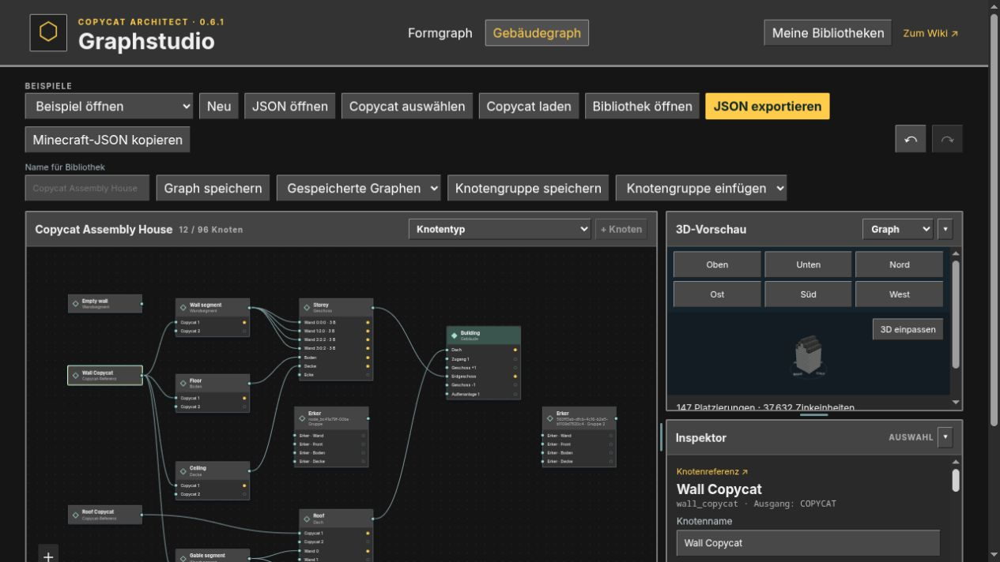

# Create: Copycat Architect 0.6.1

Graphstudio und Architektentisch verwenden jetzt denselben Modellstand. Der Browser
enthält alle zehn Form- und 36 Gebäudeknotentypen, dieselben Ein-/Ausgangstypen und
die nativen Inspektoreinstellungen. Die grauen Rahmen und dunklen Arbeitsflächen
passen zu den ComputerCraft-orientierten Modoberflächen.

- Vollständiger JSON-Codec aus 52 nativen Datenklassen, ohne eine separate Browser-Teilmenge.
- Formgraphen 1–3, Formdokumente 1–4 und Gebäudegraphen 1–4 einschließlich Projektion,
  exakter Geometrie, Dachvorlagen, semantischer Räume, Erker/Gauben und Außenanlagen.
- Native Gruppen und gemeinsame Instanzen; benannte Schnittstellen mit denselben
  Adaptern und Typregeln wie am Architektentisch.
- Inspektoren aus dem gemeinsamen Katalog, typisierte Referenzauswahl, native
  Quellbearbeitung für abgeleitete Maße und gemeinsame Geometrieänderungen.
- Boolesche Copycat-/Segmentoperationen und aktuelle native Modfunktionen zusammengeführt.
- Automatische JVM–Browser–JVM-Austauschprüfung, Typprüfung aller 72 Gebäudeknotenvarianten,
  Inspektorparität und öffentliches Manifest mit Modellfingerabdrücken.

Minecraft 1.21.1 · NeoForge 21.1.251 · Java 21.

Die exakte Geometrie bleibt im Export vollständig erhalten. Die Browser-Vorschau
stellt Schrägflächen weiterhin konservativ im 16er-Raster dar. Gebäude-JSON verweist
auf Form-/Modulversionen, die in der Spielbibliothek verfügbar sein müssen.

Validierung: vollständige Modtests und JAR-Build, Browserregressionen und
Produktionsbuild, sieben gerichtete Austauschfälle sowie manuelle Browserprüfung
von Erkern, Projektion, Material-/Rotationseinstellungen und Gruppeninstanzen.

