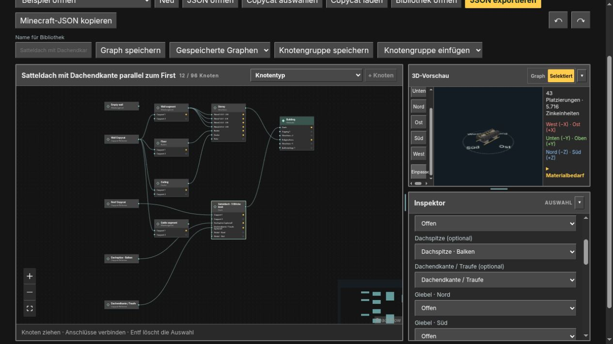

# Create: Copycat Architect 0.6.4

Neuer optionaler Copycat-Anschluss **Dachendkante / Traufe** (`roofEave`) für
Satteldächer in Graphstudio und am Architektentisch.

- Eigene Vorlage für die beiden unteren Dachrandreihen parallel zum First.
- Passende Drehung auf gegenüberliegenden Dachseiten, einschließlich Dachverlängerung.
- Unabhängig von Dachfläche, optionaler Dachspitze und Giebelmauern.
- Typgeprüfte Verbindungen, Speicherung, Gruppeninstanzen und verlustfreier JSON-Austausch.
- Beim Flachdach ausgeblendete Verbindungen bleiben erhalten.
- Bei Dachebenen belegt die vorhandene Traufenvorlage jetzt ebenfalls die unteren
  Kanten parallel zum First; die giebelseitigen Abschlusskanten verwenden den Ortgang.
- Neues Browserbeispiel **Dachendkante parallel zum First**.

Ohne Verbindung bleibt die normale Dachdeckung erhalten. Der neue Anschluss
benötigt auch im Spiel die aktualisierte Mod 0.6.4. Minecraft 1.21.1, NeoForge
21.1.251 und Java 21 bleiben unverändert.

Validierung: 576 Modprüfungen ohne Fehler (3 übersprungen), 136 bestandene
Browserprüfungen und neun erfolgreiche JVM–Browser–JVM-Austauschfälle.
Produktionsbuild und Mod-JAR erfolgreich; Verbindung, Trennen, Rückgängig und
getrennte First-/Traufenquellen zusätzlich in der Browseroberfläche geprüft.

