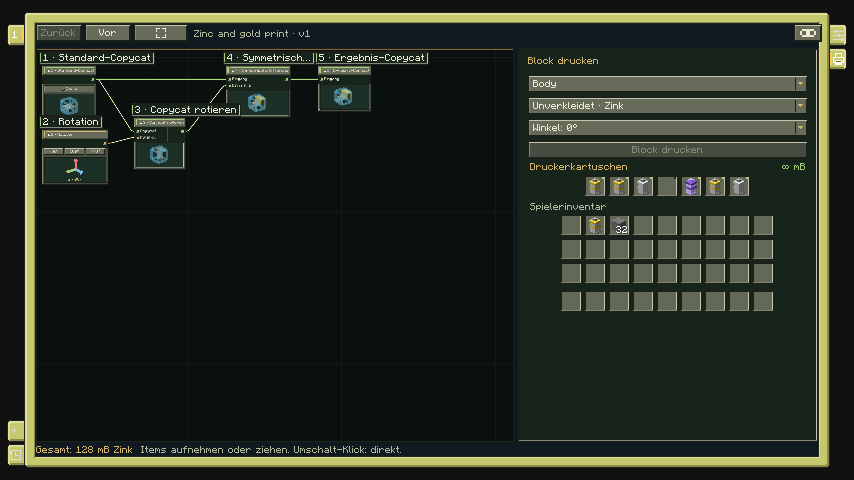
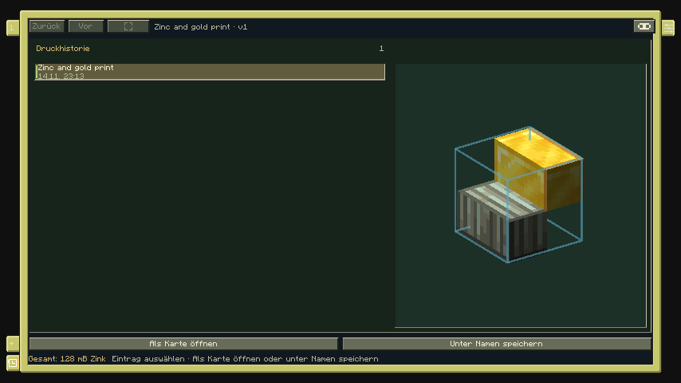

# Blockdrucker

> Stand: **8. November 2026**. Diese Spielanleitung beschreibt die **lokale Mod 0.5.1**. Der kleinere Funktionsumfang des **Graphstudio 0.2** ist im [Entwicklungsstand](Entwicklungsstand.md) getrennt ausgewiesen.

Der Blockdrucker erzeugt einen eigenen Copycat-Kompositblock **genau an seiner aufgestellten Position**. Entwurf, Materialzuordnung, Ausgabedrehung und sieben Kartuschenplätze reisen im Drucker mit. Nach dem Druck erhältst du das Gerät zurück.

## Dein erster Druck

Für einen einfachen Versuch reichen ein Drucker, eine Kartusche mit mindestens **128 mB** Zink und optional ein Verkleidungsblock, etwa Eichenbretter. Die [direkt hergestellte 144-mB-Kartusche](Installation.md) genügt für eine unveränderte halbe Stufe.

1. Nimm den **Blockdrucker** in die Hand und rechtsklicke auf einen Nachbarblock, sodass der Drucker an der gewünschten freien Position steht. Der Formgraph öffnet sich sofort.
2. Wähle den vorhandenen Grundformknoten oder füge über **Rechtsklick → Knoten hinzufügen** einen hinzu. Öffne über sein Item-Symbol den Grundformkatalog und wähle eine **Stufe**.
3. Verbinde den rechten Copycat-Ausgang der Quelle mit dem Eingang von **Ergebnis-Copycat**. Falls bereits eine Verbindung vorhanden ist, prüfe, ob sie auf diese Quelle zeigt. Die Ergebnisvorschau soll jetzt einen halben Block zeigen; die Kostenanzeige nennt **128 mB**.
4. Klicke in einen freien Bereich des Graphen. Dadurch wählst du die **Karte**. Öffne rechts den Randtab **Drucken** und lege eine gefüllte Kartusche in einen der sieben Druckerplätze. Verkleidungsblöcke bleiben im Spielerinventar.
5. Lass die Oberfläche auf **Unverkleidet · Zink**, oder wähle für die Materialgruppe beispielsweise Eichenbretter. Prüfe die gewünschte Ausrichtung. **R** dreht den gesamten Druck, solange kein Textfeld fokussiert ist.
6. Halte die Maus über das **Augensymbol**, um die Oberfläche auszublenden und den Druckort in der Welt zu sehen. Beim Verlassen des Auges kehrt der Editor zurück.
7. Wähle **Block drucken**. Der fertige Copycat ersetzt den Drucker; das Gerät kommt mit Restzink und Entwurf zurück ins Inventar. Ist dein Inventar voll, wird das Gerät als Item ausgegeben.

*Die sieben Plätze im Drucker nehmen Kartuschen auf. Unter ihnen liegt das Spielerinventar; oben wählst du Gruppe, Verkleidung und Ausgabedrehung.*

Die Grundformen im Editor sind Vorlagen. Du musst keine native Copycat-Stufe als Zutat mitbringen. Bezahlt werden Zink und die tatsächlich verwendeten Verkleidungsarten. Für komplexere Formen geht es im [Formeditor](Formeditor.md) weiter.

## Karte und Knoten auswählen

Ein **Knotenklick** wählt einen Knoten, **Umschalt + Klick** ergänzt die Auswahl. Der rechte **Inspektor** zeigt die Eigenschaften der Auswahl; du kannst ihn über seinen Randtab ein- und ausblenden. Er öffnet sich nicht bei jedem Knotenklick automatisch.

Bei mehreren ausgewählten Knoten stehen unter anderem Duplizieren, Entfernen, Materialzuweisung und Ausrichten zur Verfügung. Ein **Klick ins Leere** wechselt zurück zur Karte. Im Karteninspektor findest du Name, Speichern, Laden, neue Karte, Kopie und Schließen. Der Drucken-Tab erscheint bei Kartenauswahl.

Die linken Randtabs halten mehrere Karten offen. Jede Karte behält ihren Entwurf, Ansicht, Auswahl, Materialien, Drehung und Undo-/Redo-Verlauf. Neue Karten oder wiedergeöffnete Drucke ersetzen andere offene Entwürfe nicht.

## Kartuschen bedienen

Im Drucken-Tab kannst du Kartuschen normal aufnehmen, ablegen und ziehen. **Umschalt-Klick** verschiebt sie direkt zwischen Drucker und Spielerinventar. Rechtsklick teilt einen Stapel oder legt ein Item ab. Die sieben Druckerplätze akzeptieren ausschließlich Kartuschen.

In einem kleinen Fenster musst du im Drucken-Tab gegebenenfalls nach unten scrollen. Beim Wechsel zwischen Randtabs bleibt das Minecraft-Inventarmenü aktiv; ein aufgenommenes Item bleibt am Mauszeiger sichtbar. Beim Schließen wird es ins Inventar zurückgelegt oder bei Platzmangel ausgegeben.

Mit dem **gehaltenen Drucker in die Luft rechtsklicken** oder **Schleichen + Rechtsklick** öffnet die separate Kartuschen- und Speicherverwaltung. Ihr Schließen kehrt während einer laufenden Sitzung zum Graphen zurück.

## Speichern und Druckhistorie

**Speichern** legt eine dauerhafte Formversion in deiner Bibliothek an. Über **Laden** wählst du eine gespeicherte Version, über **Kopie** einen unabhängigen Entwurf. Beim späteren Bearbeiten entsteht eine neue Version; ältere Referenzen bleiben erhalten.

Der linke Randtab **Druckhistorie** steht unter **Karte öffnen**. Dort erscheinen bis zu **24 abgeschlossene Drucke**, jeweils mit Zeitpunkt, Materialien, Ausrichtung und Vorschau. Große Bibliotheksdaten können ältere Einträge früher verdrängen.

Wähle einen Druck und dann **Als Karte öffnen**, um ihn erneut zu bearbeiten oder zu drucken. **Unter Namen speichern** übernimmt ihn mit seinen Oberflächen und seiner Drehung als dauerhafte Formversion. Die Historie dient damit zum Wiederholen; benannte Bibliotheksversionen dienen zum dauerhaften Wiederverwenden, auch am Architektentisch.

## Abbrechen, Fehler und Abbau

**Esc beziehungsweise Abbruch im Druckgraphen** nimmt den aufgestellten Drucker ohne Druckverbrauch zurück. Entwurf und Kartuschen bleiben erhalten. Ein normales Abbauen des Druckerblocks gibt das Gerät ebenfalls mit Inhalt zurück.

Fehlendes Zink, fehlende Verkleidungen, eine ungültige Ergebnisverbindung oder eine verweigerte Platzierung lassen den Drucker stehen. Behebe die Ursache und versuche den Druck erneut. Zum Ziel dürfen keine Wesen oder andere Hindernisse kollidieren; der Drucker beachtet die Baurechte der Welt.

Beim Abbau eines fertigen Kompositblocks erhältst du bezahltes Zink und bezahlte Verkleidungsblöcke zurück. Näheres zur nachträglichen Verkleidung und Rückgabe steht unter [Kartuschen und Materialien](Kartuschen-und-Materialien.md). Weitere Problemlösungen findest du in der [Fehlerhilfe](Fehlerhilfe.md).

[Entwicklungsstand und Kompatibilität](Entwicklungsstand.md) · [Knotenreferenz](Knotenreferenz.md) · [Einheiten](Einheiten-und-Ausrichtung.md)
