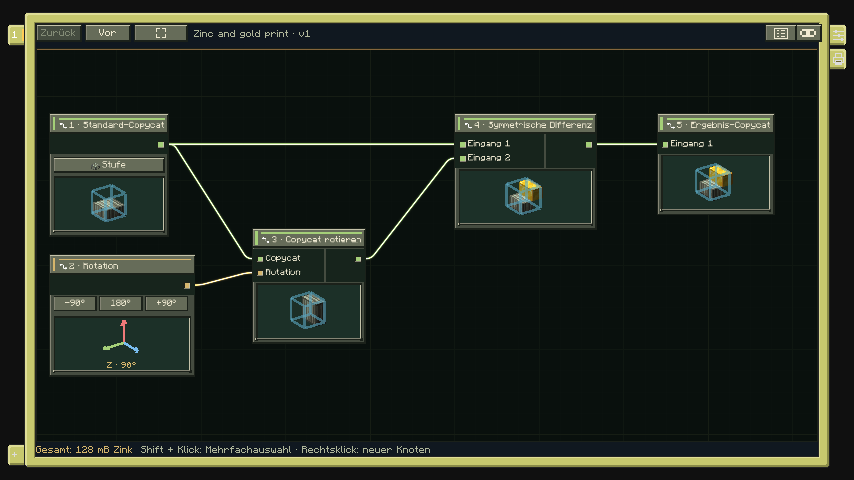
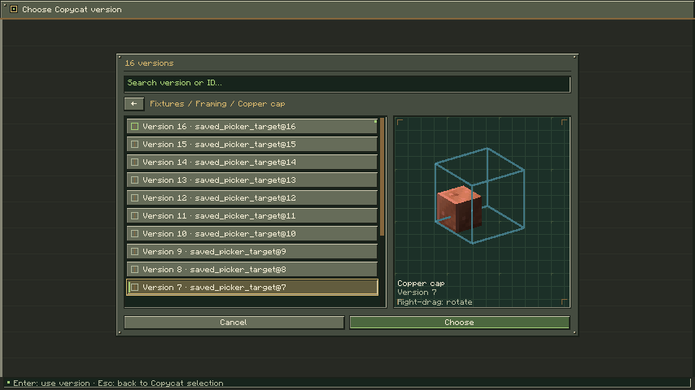
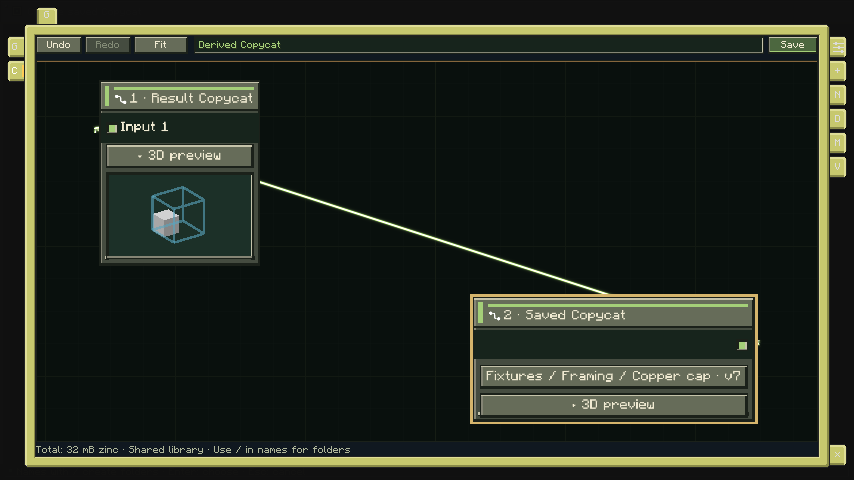
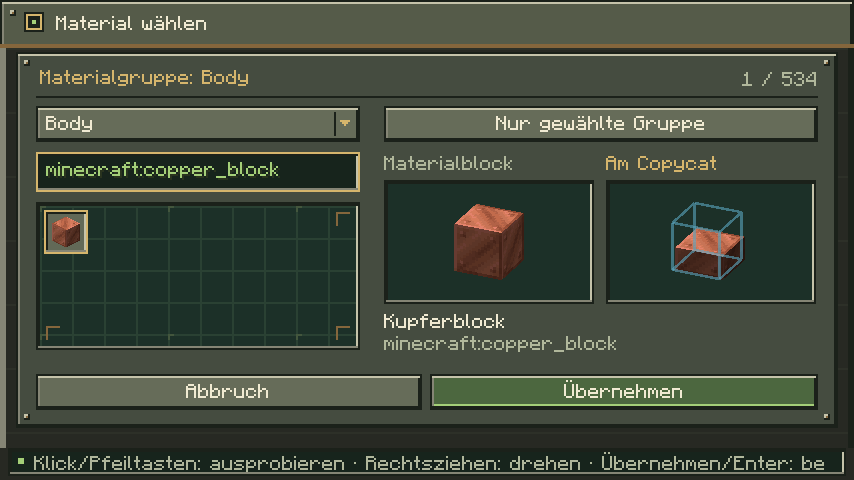

# Formeditor

> Stand: **8. November 2026**. Diese Spielanleitung beschreibt die **lokale Mod 0.5.1**. Der kleinere Funktionsumfang des **Graphstudio 0.3** ist im [Entwicklungsstand](Entwicklungsstand.md) getrennt ausgewiesen.

[Wiki-Start](Home.md) · [Blockdrucker](Blockdrucker.md) · [Kartuschen und Materialien](Kartuschen-und-Materialien.md)

Im Formeditor setzt du geometrische Copycat-Quellen zu einer eigenen Form zusammen. Jede fertige Form bleibt innerhalb **einer Blockposition**; die üblichen Quellen nutzen **16 × 16 × 16** Teilzellen. Diagonale Spiegelungen können zusätzlich exakte rationale Schnittgeometrie verwenden. Sichtbare Form und Kollision folgen derselben Geometrie. Für mehrere Blockpositionen verwendest du die [Gebäudeplanung](Gebaeudeplanung.md).

Der aufgestellte [Blockdrucker](Blockdrucker.md) öffnet den Formgraphen. Auch beim Bearbeiten einer Form aus einem Gebäude oder Modul begegnet dir derselbe Editor.

[**Formgraph im Browser öffnen**](https://teutonstudio.github.io/copycat-architect/?editor=form) · [Browserumfang und Vorschau](Graphstudio.md) · [Alle Formknoten und Anschlüsse](Knoten-Formgraph.md)

*Jeder Geometrieknoten zeigt sein eigenes Zwischenergebnis. Der Rotationswert zeigt stattdessen Achse und Winkel.*

## Den Graphen bedienen

Über **Rechtsklick → Knoten hinzufügen** öffnest du den Katalog. Eine Quelle heißt im Graphen **Standard-Copycat**. Ziehe eine Verbindung von ihrem rechten Ausgang zum passenden Eingang des nächsten Knotens. Der letzte Geometrieausgang muss mit **Ergebnis-Copycat** verbunden sein. Eine Quelle darf mehrere Zweige versorgen.

Ein Klick wählt einen Knoten; **Umschalt + Klick** ergänzt die Auswahl. Der rechte Randreiter **Inspektor** öffnet die Eigenschaften. Die Auswahl selbst klappt ihn nicht automatisch auf. Bei Mehrfachauswahl kannst du Knoten duplizieren, entfernen, einer Materialgruppe zuweisen und ausrichten. Ein Klick auf eine freie Stelle wählt die gesamte Karte. Dann sind die Kartenaktionen und der rechte Drucken-Reiter erreichbar.

Der Button mit dem Item-Symbol einer Quelle öffnet den Grundformkatalog. Suche nach Namen oder Registry-ID und wähle die passende Form. Die Auswahl verbraucht keine Copycat-Items. **Strg+F** fokussiert die Suche; Pfeiltasten und Eingabe erlauben die Tastaturauswahl. **Esc** schließt den Katalog ohne Änderung.

Im eingebetteten Formeditor zeigen **Graph** und **Bedienfeld** denselben Entwurf: Der Graph bearbeitet Verbindungen räumlich, das Bedienfeld über Auswahllisten. Zahlenwerte öffnen Eingabefelder mit zulässigem Bereich. **Speichern** oder Eingabe übernimmt einen gültigen Wert; Abbruch oder Esc verwirft ihn.

## Gespeicherte Copycats weiterverwenden

Über **Rechtsklick → Knoten hinzufügen → Copycat-Bibliothek → Gespeicherter Copycat** fügst du eine gespeicherte Form als Quelle in den aktuellen Formgraphen ein. Im eingebetteten Editor ist sie auch unter **Knoten einfügen** verfügbar. Der Bibliotheksdialog bietet Ordner, Suche und eine 3D-Vorschau. Gleiche vollständige Namen erscheinen als ein Eintrag mit Versionsanzahl. Bei mehreren Versionen öffnet **Version wählen** einen eigenen Dialog, in dem die neuesten Versionen zuerst stehen. Eine bereits verwendete Version bleibt vorausgewählt; neue Quellen beginnen mit der neuesten Version. Jede Version besitzt ihre eigene Geometrie- und Materialvorschau. Suche nach einer exakten `ID@Version` ist weiterhin möglich. **Esc** im Versionsdialog kehrt zur Namensliste zurück und übernimmt keine Änderung. Formen mit gleichem Kurznamen in unterschiedlichen Ordnern bleiben getrennt; bei nur einer Version genügt die direkte Auswahl.

Verbinde ihren Ausgang mit einer Operation oder direkt mit **Ergebnis-Copycat**. So kannst du gespeicherte Formen vereinigen, zuschneiden, drehen oder spiegeln und das Ergebnis als neue Form speichern. Der Quellenbutton zeigt Name und Version; über ihn wählst du eine andere gespeicherte Form. Verbindungen, Position und Quelldrehung bleiben beim Austausch erhalten.

Die Quelle übernimmt die gewählte Version einschließlich ihrer Geometrie, Materialgruppen, Verkleidungen und gespeicherten Ausgabedrehung als unabhängige Kopie. Die Bibliotheksvorlage bleibt unverändert. Auch eine daraus gespeicherte Form lässt sich erneut als Quelle verwenden. Einfügen und Quellenwechsel lassen sich jeweils zusammen mit den übernommenen Materialien rückgängig machen. **Esc** im Auswahlfenster verwirft die Auswahl. Für den gesamten Entwurf gelten weiterhin höchstens acht Materialgruppen.

## Grundformen und Dachquelle

Der aktuelle Katalog enthält 18 native Copycat-Quellen, zwei Scheibenanteile und zusätzlich die eigene Dachquelle `copycat_architect:copycat_roof`:

| Familie | Formen |
|---|---|
| Große Grundformen | Vollblock, Stufe, Treppe, Balken, Byte |
| Paneele und Scheiben | Panel, halbes Panel, Byte-Panel, mittige Scheibe, halbe Scheibe, Halbbyte-Scheibe (¼) |
| Leisten und Schichten | Gerade Leiste (`copycat_slice`), vertikale Leiste (`copycat_vertical_slice`), Eckscheibe, Schicht, feste Leiste (`create:copycat_step`), feste vertikale Leiste (`copycat_vertical_step`) |
| Halb-Schichten | Halbe Schicht, vertikale halbe Schicht, gestapelte halbe Schicht |

Einige Bezeichnungen ähneln sich: Die größenverstellbare **Gerade Leiste** und die feste **Leiste** sind unterschiedliche Quellen. Bei Unsicherheit helfen Item-Vorschau und Registry-ID im Katalog. Die mittige Scheibe ist 2/16 Block dick. Ihre halbe und Viertelvariante verkleinern die Fläche, nicht die Dicke.

Schicht- und bestimmte Leistenformen besitzen acht Größenstufen. Versätze werden in **hB = 1/16 Block** angegeben. [Achsen und Enums](Einheiten-und-Ausrichtung.md) erklären die Ausrichtung. Kein Teil darf über die Blockgrenzen hinausragen. Welche räumlichen Drehungen zulässig sind, hängt von der Quelle ab.

## Operationen verstehen

| Knoten | Wirkung |
|---|---|
| Vereinigung | Behält alle belegten Bereiche der Eingänge. Überlappung zählt einmal. |
| Schnitt | Behält nur den Bereich, den alle Eingänge gemeinsam belegen. |
| Differenz A − B | Entfernt die Geometrie von B aus A. Die Reihenfolge zählt. |
| Symmetrische Differenz | Bei zwei Eingängen bleibt der jeweils allein belegte Bereich; ihre Überlappung verschwindet. |
| Copycat spiegeln | Spiegelt an einer Ebene durch die Blockmitte; die lokale Mod bietet auch diagonale Ebenen. |
| Gespeicherter Copycat | Verwendet eine unabhängige Momentaufnahme einer gespeicherten Formversion. |
| Copycat rotieren | Dreht den angeschlossenen Geometriezweig. |
| Rotation | Liefert Achse und Winkel an einen Rotationsanschluss. |

Vereinigung, Schnitt und symmetrische Differenz können zwei bis 16 Eingänge besitzen. Bei mehr als zwei Eingängen entspricht die symmetrische Differenz einem XOR: Bereiche mit ungerader Anzahl von Überdeckungen bleiben erhalten. Differenz besitzt genau die Eingänge A und B.

**Rotation** liefert keine Form. Verbinde diesen Wert mit dem Rotationseingang von **Copycat rotieren**. Ohne externen Rotationswert lassen sich Achse und Winkel direkt am Verarbeitungsknoten einstellen. X, Y und Z sind Weltachsen; **Fläche** dreht um die lokale Flächenachse. Es gibt Vierteldrehungen von 0°, 90°, 180° und 270°.

**R** dreht die gesamte Druckausgabe um die vertikale Achse, solange kein Textfeld fokussiert ist. Verwende einen Rotationsknoten, wenn nur ein Zweig gedreht werden soll.

## Beispiel: eine dünne Winkelleiste

1. Füge eine **Gerade Leiste** ein und stelle Größe 1 ein.
2. Leite ihren Ausgang direkt in den ersten Eingang einer **Vereinigung**.
3. Verbinde denselben Quellausgang zusätzlich mit **Copycat rotieren**.
4. Wähle dort die Y-Achse und 90°.
5. Verbinde den gedrehten Ausgang mit dem zweiten Vereinigungseingang.
6. Verbinde die Vereinigung mit **Ergebnis-Copycat**.
7. Prüfe die rechtwinklige Vorschau, benenne die Karte und drucke sie nach der [Druckeranleitung](Blockdrucker.md).

Beide Arme stammen aus derselben Quelle. Eine Änderung der Größe verändert deshalb beide zugleich. Für unabhängig einstellbare Arme verwendest du zwei Quellen.

## Materialien, Speichern und Fehler

Im **Copycat-Graph am Architektentisch** erscheinen die Formen zunächst neutral und ohne Materialtexturen. Über den rechten Randreiter **V – Materialvorschau** blendest du die gewählten Materialien im Graph und im Inspektor ein oder aus. Das ist eine reine Ansichtseinstellung; Materialzuordnungen und Rückgängig-/Wiederholen-Historie bleiben erhalten.

Über **Gruppen** legst du bis zu acht Materialgruppen an. Quellen erhalten ihre Gruppe im Inspektor. **Gruppiert** weist einer Operation eine gemeinsame Gruppe zu; **Separiert** erhält eingehende Zuordnungen. Vereinigung und symmetrische Differenz erlauben zusätzliche Gruppenzuweisungen je Eingang. Schnitt und Differenz behalten bei separierter Verarbeitung die Materialien von A. Bei überlappenden Gruppen gewinnt die höhere Vordergrundpriorität. Oberflächen und Kosten erklärt [Kartuschen und Materialien](Kartuschen-und-Materialien.md).

Am Architektentisch öffnet **Material** direkt am Copycat-Knoten den Blockkatalog für dessen Gruppen und Gebäude-Materialrollen. Im separaten Copycat-Formeditor am Tisch gibt es zusätzlich den rechten Randreiter **M – Material wählen**. Im Formeditor und im Drucker öffnest du den Katalog über die Materialschaltfläche der gewählten Gruppe. Suche nach Blocknamen oder Registry-ID und klicke auf einen Block: Links siehst du dessen echtes Blockmodell, rechts seine Anwendung auf den Copycat. **Nur gewählte Gruppe** isoliert den betroffenen Bereich unter Berücksichtigung der Vordergrundpriorität; **Gesamter Copycat** zeigt ihn mit den übrigen Materialien. Rechtsziehen dreht die Vorschauen. Im Drucker steht auch **Unverkleidet** zur Wahl.

Du kannst mehrere Gruppen im selben Dialog ausprobieren. Erst **Übernehmen** oder **Enter** bestätigt alle Änderungen gemeinsam; **Abbruch** oder **Esc** verwirft sie. **Strg+Z/Y** nimmt die bestätigte Auswahl zurück bzw. stellt sie wieder her. Die gewählten Materialien werden mit der Formversion gespeichert. Auswahl und Vorschau bewegen keine Inventaritems; beim tatsächlichen Druck gelten die normalen Materialkosten.

Klicke ins Leere und öffne den Karteninspektor zum Benennen, **Speichern**, **Laden** oder Erstellen einer **Kopie**. Speichern legt eine neue unveränderliche Formversion an. Vollständig verdeckte oder wirkungslose Teile werden dabei bereinigt. Mehrere Karten behalten ihre eigenen Einstellungen und ihren Undo-Verlauf. **Strg+Z** macht rückgängig, **Strg+Y** wiederholt.

Ein leeres Ergebnis oder eine fehlende Verbindung verhindert den Druck. Gültige Quellen zeigen trotzdem ihre Zwischenergebnisse: Folge ihnen bis zum ersten fehlerhaften Knoten. Weitere Hinweise stehen in der [Fehlerhilfe](Fehlerhilfe.md); fertige Dateien und JSON-Austausch unter [Beispiele und Import](Beispiele-und-Import.md).
