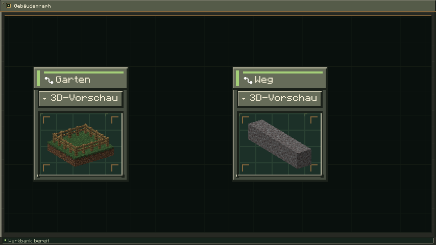
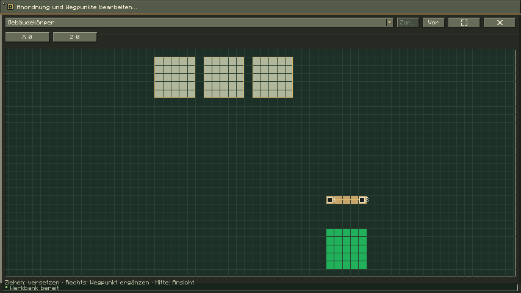
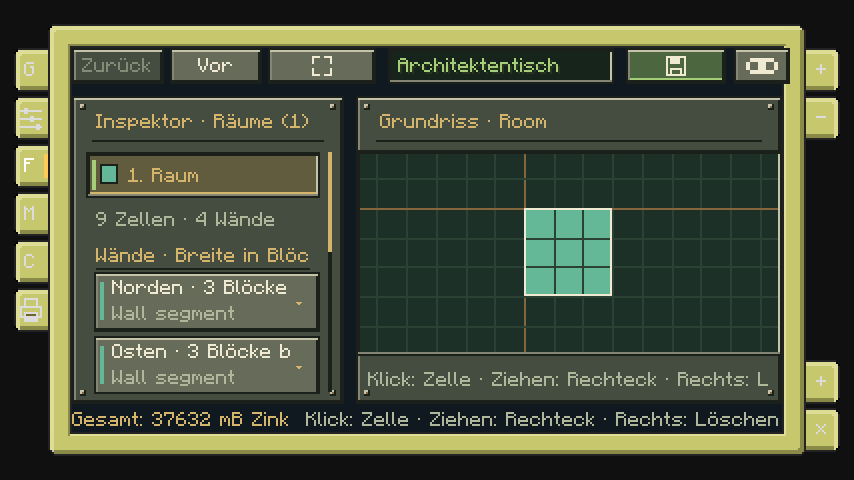
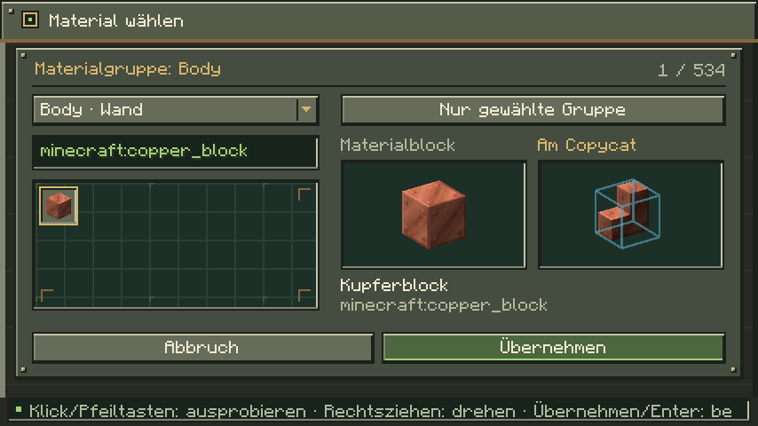

# Gebäude am Architektentisch planen

> Stand: **13. November 2026**. Diese Spielanleitung beschreibt die **lokale Mod 0.5.1**. Der kleinere Funktionsumfang des **Graphstudio 0.3** ist im [Entwicklungsstand](Entwicklungsstand.md) getrennt ausgewiesen.

[Knoten und Anschlüsse](Knoten-Gebaeudegraph.md) · [Raumaufbau, Fassaden und Anschlüsse](Raumaufbau-und-Fassaden.md) · [Älteren Gebäudegraph im Browser öffnen](Graphstudio.md)
[Wiki-Start](Home.md) · [Formeditor](Formeditor.md) · [Beispiele und Import](Beispiele-und-Import.md) · [Turtle-Bau](Turtle-Bau.md) · [Fehlerhilfe](Fehlerhilfe.md)

Am **Architektentisch** setzt du gespeicherte Copycat-Formen zu Wänden, Räumen und Stockwerken zusammen. Der fertige Entwurf enthält die Baupositionen und den Materialbedarf für einen Turtle-Auftrag. Diese Seite beschreibt den lokalen Entwicklungsstand **0.5.1** und verwendet den aktuellen Graphentwurf als Einstieg.

Im Browser kannst du die Knoten und Verbindungen eines Gebäudegraphen bearbeiten. [Gebäudegraph öffnen](https://teutonstudio.github.io/copycat-architect/?graph=building) · [JSON mit Minecraft austauschen](Graphstudio.md)

## Einen Entwurf beginnen

Stelle den Architektentisch auf und öffne ihn per Rechtsklick. Das **+ rechts unten** öffnet das Menü **Entwurf**. Wähle **Neuer Gebäudeentwurf mit Graph**. Der Startentwurf enthält bereits einen verbundenen Raum mit Boden, Decke und Stockwerk. Du kannst ihn schrittweise verändern. Gib oben einen Namen ein und verwende die Diskettentaste **Speichern**.

Die linken Randreiter öffnen **Graph**, **Bedienfeld**, **Grundriss**, **Module**, **Material** und **Bauen**. Im Graph blendet der rechte Reiter **Inspektor** die Eigenschaften des ausgewählten Knotens ein. Das Bedienfeld zeigt dieselben Definitionen in sechs Abschnitten: **Segmente**, **Räume**, **Stockwerke**, **Gebäude**, **Dach** und **Außenbereich**. Ein Ansichtswechsel erhält den Entwurf.

Oben liegen **Zurück**, **Vor** und **Einpassen**. Mit **Strg+Z** und **Strg+Y** kannst du Änderungen rückgängig machen beziehungsweise wiederholen. Zahleneingaben werden erst nach gültiger Eingabe übernommen; **Esc** verwirft einen offenen Eingabedialog.

## Im Kreativ bauen und Tisch umstellen

Im Reiter **Bauen** erscheint für Kreativspieler **Im Kreativ bauen**, solange der tatsächlich geöffnete Architektentisch in Reichweite ist. Die Aktion baut den aktuellen Entwurf sofort und ohne Materialkosten. Ändere anschließend den Entwurf und baue erneut, um das zugehörige Gebäude zu aktualisieren.

Der Tisch speichert seinen Gebäudeentwurf, Ursprung, Drehung und die genaue Zugehörigkeit jedes von ihm gebauten Copycats dauerhaft in der Welt. Auch neue Turtle-Aufträge dieses Tisches führen diese Zuordnung mit. Ein erneuter Kreativbau entfernt geänderte oder entfallene eigene Copycats, einschließlich alter Positionen nach dem Verschieben eines Gebäudeteils. Fremde Copycats werden nicht übernommen oder gelöscht, selbst wenn sie genauso aussehen oder später an einer früher eigenen Position eingesetzt wurden. Blockiert ein fremder Block eine benötigte Bau- oder Freiraumposition, wird der gesamte Bau abgelehnt. Schutzrechte gelten auch im Kreativmodus; eine abgebrochene Platzierung stellt den vorherigen Zustand wieder her.

Normale Boden- und Zaunblöcke werden auf freien Positionen gebaut oder bei Übereinstimmung weiterverwendet. Die automatische Bereinigung betrifft eigene Copycats; vorhandenes natürliches Gelände wird nicht abgegraben.

Beim Abbauen behält das gedroppte Tisch-Item seine Gebäudezuordnung. Stelle es an einer anderen Stelle auf: Das vorhandene Gebäude bleibt stehen, und der Tisch berechnet seinen relativen Abstand neu. Beim Öffnen wird dessen gespeicherter Entwurf geladen. Ein frischer Tisch desselben Spielers erkennt außerdem ein nahe gelegenes Gebäude, dessen bisheriger Tisch entfernt wurde, sofern die Zuordnung eindeutig ist. Ein noch vorhandener Tisch oder ein anderer Besitzer verhindert die Übernahme.

Ältere Turtle-Bauten können anhand der gespeicherten Bauaufträge und der tatsächlichen Platzierungsbelege erkannt werden, wenn eine genau passende gespeicherte Gebäudevorlage vorhanden ist. Unbekannte Altbauten werden nicht allein nach Position oder Aussehen als Eigentum eingestuft.

## Der aktuelle Gebäudegraph

Der Aufbau besteht aus mehreren wiederverwendbaren Quellen:

| Definition | Aufgabe |
| --- | --- |
| **Copycat** | Gespeicherte Form und Materialrolle auswählen |
| **Flächengebiet** | Wiederverwendbare Liste zweidimensionaler Rasterpunkte |
| **Segmentgeometrie** | Flächengebiet und Tiefe eines Segments festlegen |
| **Segment** | Geometrie mit Copycats für Innenfläche, Seiten, Kanten und Ecken belegen |
| **Raumgeometrie** | Flächengebiet und Raumhöhe verbinden |
| **Raum** | Geometrie, Wände, Boden und Decke zusammenführen |
| **Stockwerk** | Räume als verschiebbare Instanzen anordnen |
| **Garten** | Rasterfläche mit Oberfläche, Bodenaufbau und optionalem Zaun |
| **Weg** | Geordneten Pfad mit Breite, Höhenverlauf und Bodenaufbau erzeugen |
| **Gebäude dieses Tisches** | Stockwerke als Erd-, Ober- und Untergeschosse verbinden |

Neue Knoten entstehen über das Rechtsklickmenü im Graph oder **+ Definition** im Bedienfeld. Ziehe ein Kabel vom Ausgang einer Quelle an einen passenden Eingang. Unpassende Anschlüsse nehmen das Kabel nicht an. Kopfzeilen verschieben Knoten; Rechts- oder Mittelziehen im Hintergrund verschiebt die Ansicht, das Mausrad zoomt. **Entf** entfernt ausgewählte Kabel oder zulässige Knoten. Das Gebäude-Ergebnis und **Leere Wand** bleiben erhalten.

## Segmente für Wände und Platten

Wähle zunächst an einer **Copycat**-Quelle eine gespeicherte Form und ihre Materialrolle. Eigene Formen erstellst du im [Formeditor](Formeditor.md). Verbinde die Quelle mit einem **Segment** und dessen Eingang **Segmentgeometrie** mit einer passenden Anordnung.

Die Segmentgeometrie legt **Länge**, **Höhe** und **Tiefe** fest. Ihr optionaler Eingang **Flächengebiet** übernimmt die zweidimensionale Rasterform; ohne verbundene Quelle bleiben bestehende Rechteckdefinitionen nutzbar. Ohne eigene Belegung wiederholt das Segment seine verbundenen Copycats automatisch zeilenweise. Mehrere Quellen können so beispielsweise abwechselnde Fassadenfelder bilden.

Für eine genaue Belegung öffnest du an der Anordnung **Copycat-Anordnung bearbeiten**. Das Format lautet:

```text
x,y,Copycatnummer,Drehung; x,y,Copycatnummer,Drehung
```

Beispiel: `0,0,1,0; 1,0,2,90` verwendet an zwei Positionen die erste und zweite Copycat-Quelle. Koordinaten beginnen bei null, Copycatnummern bei eins. Zulässige Drehungen sind **0, 90, 180 und 270 Grad**. Bei einer ausdrücklichen Belegung bleiben ausgelassene Zellen frei. Eine leere Liste schaltet zur automatischen Wiederholung zurück. Das kleine Raster zeigt die Belegung; bearbeitet wird sie über die Liste.

Ein Segment wird je nach Raumanschluss senkrecht als Wand oder waagerecht als Boden beziehungsweise Decke eingebaut: **Wand: XY · Boden/Decke: XZ**. Die zweite Anordnungskoordinate beschreibt bei einer Platte also die Tiefe. Der Einbau dreht die vollständige Segmentgeometrie einschließlich ihrer Zellpositionen. Gespiegelte Schichten behalten dadurch in Vorschau und Bauwerk dieselbe Reihenfolge und dieselben Anschlüsse; zwei aneinander angeordnete 3/16-Schichten bleiben eine zusammenhängende 6/16-Wand.

Feste Wandsegmente müssen genau zur Breite und Höhe ihres Wandanschlusses passen. Boden und Decke benötigen das rechteckige **Außenmaß einschließlich Wandhülle**. Deshalb verwendet der Startraum mit **3 × 3 Innenzellen** eine **5 × 5** große Plattenanordnung. Wenn du den Raum vergrößerst, passe auch seine Segmente an. Bei unregelmäßigen Räumen werden Plattenzellen außerhalb der Raumhülle ausgelassen.

Die Randanschlüsse eines Segments sind im Graph und im Bedienfeld als **Ecke**, **Kante**, **Fläche** oder **Inneres** beschriftet. Die anschließenden Richtungen kennzeichnen ihre Lage, beispielsweise **Ecke · Links / Unten / Vorne** oder **Fläche · Vorne**. Jede Region nimmt eine eigene Copycat-Quelle an; die normalen Copycat-Eingänge bleiben die Vorgabe für unbelegte Regionen. Schrumpft eine Achse auf **1**, vereinigt sich ihr gegenüberliegendes Anschlusspaar. Bei zwei Blöcken entfällt der Innenbereich dieser Achse.

**Segmente vereinigen** verbindet Segmente **Nebeneinander**, **Übereinander**, **Hintereinander** oder über **Transformationen**. Nebeneinander müssen die festen Höhen, übereinander die festen Längen übereinstimmen. Verschachtelte Zusammensetzungen sind möglich; feste Fenster werden dabei nicht gedehnt oder abgeschnitten. Unter **Transformationen bearbeiten** steht je Eingang ein Eintrag im Format `x,y,z,Achse,Grad`, getrennt durch Semikolons. Beispiel: `0,0,0,Y,0; 3,0,0,X,90`. Drehungen verwenden X/Y/Z und 0/90/180/270 Grad. Die Position bezieht sich auf die minimale Ecke nach der Drehung. Überlappende Copycat-Geometrien werden samt ihren Materialgruppen und Materialien vereinigt; bei Materialüberschneidungen hat die frühere Quelle Vorrang. Luftzellen anderer Segmente lassen die Copycats bestehen. Nur die übrigen Luftzellen werden freigehalten. Widersprüchliche native Vollblöcke werden weiterhin abgelehnt.

## Garten und Weg



Im Abschnitt **Außenbereich** legst du **Garten** und **Weg** an. Verbinde ihre Ausgänge mit den optionalen Eingängen **Außenbereich 1**, **Außenbereich 2** usw. am Gebäude-Ergebnis. Jeder Knoten hat eine eigene 2D-/3D-Vorschau und erscheint nach dem Verbinden im gemeinsamen Bauplan. Die Quellen beschreiben die lokale Fläche beziehungsweise den Ausgangspfad. Die gemeinsame Platzierung und die instanzbezogenen Wegpunkte gehören zum **Gebäude-Knoten**. Überschneidende, widersprüchliche Bauteile werden als Fehler angezeigt.

Öffne am **Gebäude-Knoten** **Anordnung und Wegpunkte bearbeiten**. In diesem gemeinsamen Plan werden der graue **Gebäudekörper**, angeschlossene grüne **Gärten** und beige **Wege** angeordnet. Die Auswahl oben unterscheidet die einzelnen Anschlüsse, auch wenn dieselbe Quelle mehrfach verbunden ist.

- **Linksklick und Ziehen** auf Gebäudekörper oder Garten versetzt das ausgewählte Objekt. Beim Gebäudekörper bewegen sich alle Stockwerke und das Dach zusammen. Die **X-/Z-Felder** oben erlauben genaue Eingaben.
- Die markierten **Wegpunkte** lassen sich einzeln mit der linken Maustaste ziehen. Die Punktauswahl und das **Y-Feld** bearbeiten die Höhe.
- **+** und ein anschließender Klick im Plan ergänzen einen Punkt hinter dem ausgewählten Punkt; ein **Rechtsklick** im Plan ergänzt ihn direkt. **−** beziehungsweise **Entf** entfernt den ausgewählten Punkt, solange mindestens zwei Punkte bleiben.
- **Mittlere Maustaste ziehen** verschiebt die Ansicht, das **Mausrad** zoomt und **Einpassen** zeigt wieder die gesamte Anordnung.

Während des Ziehens bleibt die Änderung eine Vorschau. **Loslassen** übernimmt einen einzelnen Undo-Schritt; **Esc** verwirft eine laufende Bewegung. Zurück/Vor beziehungsweise **Strg+Z / Strg+Y** verwenden dieselbe Historie wie das Gebäude. Änderungen an der Anordnung und an Wegpunkten werden pro Anschluss im Gebäude gespeichert. Wiederverwendete Gartenflächen und Wegquellen bleiben erhalten. Die Quellenknoten behalten ihre Flächen-, Zaun-, Breiten- und Bodeneinstellungen.



Ein **Garten** belegt eine Fläche aus `x,z`-Rasterpunkten. Du kannst Zellen im Raster umschalten oder über **Rasterpunkte bearbeiten** eingeben. Ein verbundener **Flächengebiet**-Knoten liefert eine wiederverwendbare Fläche; beim Bearbeiten änderst du dann diese gemeinsame Quelle. Auch Löcher und getrennte Gartenstücke sind zulässig. **Einzäunen** schaltet einen Zaun auf den inneren Randzellen der Fläche ein. Zaunmaterial und Höhe (1–4 Blöcke) sind wählbar; Ecken werden nur einmal berechnet, Löcher ebenfalls eingefasst.

Ein **Weg** verbindet geordnete Punkte im Format `x,y,z; x,y,z; …`. Beispiel: `10,0,0; 10,0,5; 14,2,5` ergibt einen abknickenden Weg mit einem ansteigenden Abschnitt. Die Reihenfolge bleibt erhalten; zwischen zwei Punkten wird die Höhe in Blockstufen interpoliert. Maximal ein Block Höhenänderung pro Rasterabschnitt ist zulässig. Die Wegquelle liefert die Anfangspunkte; den Verlauf eines angeschlossenen Weges bearbeitest du in der gemeinsamen Anordnung des Gebäude-Knotens. Dort lassen sich Punkte verschieben, ergänzen, löschen und in der Höhe anpassen. Die **Wegbreite** reicht von 1 bis 16 Blöcken; bei gerader Breite liegt der zusätzliche Rand auf der positiven X-/Z-Seite.

Beide Knoten bieten **Oberfläche**, **Bodenhöhe**, **Bodenaufbau**, **Untergrund** und **Freiraum über Boden**. Der Bodenaufbau umfasst die Oberfläche und bis zu 15 darunterliegende Untergrundschichten. Die Bodenhöhe verschiebt die gesamte Geometrie, beim Weg zusätzlich zu seinen Punkthöhen. Der optionale **Boden**-Eingang nimmt eine Copycat-Quelle als Oberfläche an; ohne Verbindung wird der gewählte normale Block verwendet. Standard sind Grasblöcke im Garten und Kies auf Wegen. Die Materialliste enthält den vollständigen Bodenaufbau und Zaun; normale Blöcke verbrauchen ihre Items und kein Zink.

**Freiraum** beschreibt die im Bauplan erforderliche freie Höhe. Vorhandenes Gelände muss für den Bau weiterhin vorbereitet sein; der Bauauftrag gräbt keine Blöcke automatisch ab. Bei einem Garten werden die eigenen Zaunblöcke innerhalb dieses Freiraums berücksichtigt.

## Räume im Grundriss zeichnen

Ein neuer Raum benötigt eine **Raumgeometrie**-Quelle. An dieser Quelle werden **Raumhöhe** und bei Bedarf ein geteiltes **Flächengebiet** verbunden. Ein allgemeines Flächengebiet darf Lücken oder getrennte Bereiche enthalten; beim Einsatz als Raum gelten zusätzlich die folgenden Raumregeln. Über **Rasterpunkte bearbeiten** kannst du Innenzellen als `x,z; x,z; …` eingeben. Ein 2 × 2-Raum lautet beispielsweise `0,0; 1,0; 0,1; 1,1`. Im Quellenraster von **Flächengebiet** und **Raumgeometrie** schaltet ein Linksklick einzelne Zellen um; mit gedrückter linker Maustaste ziehst du ein gefülltes Rechteck auf. Rechtsklick oder Rechtsziehen entfernt Zellen. Beim Ziehen bleibt die Fläche eine Vorschau: Loslassen übernimmt einen Undo-Schritt, **Esc** verwirft ihn. **Raumgeometrie öffnen ↗** führt vom Raum zu seiner Quelle.

Für größere Änderungen ist der Reiter **Grundriss** praktischer. Wähle links den gewünschten Raum:

- **Linksklick** schaltet eine einzelne Innenzelle um.
- **Linksziehen** ergänzt ein Rechteck.
- **Rechtsklick oder Rechtsziehen** entfernt Zellen.
- **Mausrad** zoomt; **Mittelziehen** verschiebt die Ansicht.
- **Esc** verwirft eine laufende Zeichenaktion.

Während des Ziehens siehst du eine Vorschau. Erst das Loslassen übernimmt die Änderung als einen gemeinsamen Undo-Schritt. Ein Raum muss mindestens eine Zelle behalten, über gemeinsame Kanten verbunden bleiben und darf keine eingeschlossenen Löcher enthalten. Innenflächen verschiedener Räume dürfen sich nicht überlappen.



*Der gemeinsame Grundriss und die Randreiter. Dieses Bild zeigt einen älteren Startentwurf; aktuelle Räume besitzen zusätzlich eine eigene Raumgeometrie-Quelle.*

Unter dem ausgewählten Raum listet der Inspektor alle Wandläufe mit Richtung und Breite auf. Wähle dort passende Segmentquellen sowie **Boden** und **Decke**. Jede **vertikale Kante** besitzt einen eigenen Segmenteingang, auch an einspringenden Ecken. Der Anschluss nennt die X/Z-Koordinate des Eckpunkts und die Raumhöhe. Das Segment muss genau diese Höhe und den Querschnitt der beiden angrenzenden Wandtiefen besitzen, beispielsweise **1 × 4 × 1** bei ein Block tiefen Wänden. Die Wände werden mit ihren vorhandenen Endreihen überlappend zusammengesetzt. An jeder Ecke werden die beiden vertikalen Blockreihen samt Copycat-Geometrie vereinigt; zusätzliche Eckpfeiler entfallen. Dadurch wird das freie Innenmaß kleiner. Das Kantensegment wird passend gedreht und in diesen gemeinsamen Querschnitt eingesetzt; seine Verkleidung hat bei Überschneidungen Vorrang. **Leere Wand** hält die Kante frei. Ohne eigene Verbindung bleiben die vereinigten Wandenden beziehungsweise der optionale gemeinsame **Eckleisten-Copycat** erhalten. An einspringenden Ecken zeigt der Wandanschluss die einschließlich der gemeinsamen Endzelle benötigte Segmentbreite. Größere vorhandene Boden- und Deckensegmente werden mittig auf die tatsächliche Raumhülle zugeschnitten. Die Kontur erzeugt die Wandanschlüsse automatisch. Neue Läufe erhalten zunächst **Leere Wand**; bestehende Zuordnungen bleiben möglichst erhalten.

**Leere Wand** passt sich jeder Wandgröße an und fordert freien Raum. Sie verbraucht keine Items und entfernt keine vorhandenen Weltblöcke. Auch die Copycat-Auswahl enthält **Luft / freie Zelle** für einzelne Wandlücken. Luft fordert freie Zellen und verursacht keine Materialkosten. Die Tiefe einer Segmentgeometrie bestimmt ihre Schichtzahl. Am Raum stehen außerdem Innenmaß, Außenmaß und Gesamthöhe.

Mehrere Räume können dieselbe Raumgeometrie verwenden. Eine Änderung dieser Quelle gilt dann für **alle abhängigen Räume**. Auch mehrere Instanzen derselben Raumdefinition teilen ihre Kontur.

## Stockwerke und Tischbezug

Öffne **Bedienfeld → Stockwerke** und wähle links ein Stockwerk. Ziehe seine Raumflächen im Raster an die gewünschte Position. Im kompakten Fenster wechseln **Eigenschaften** und **Räume verschieben** zwischen den Ansichten. Über **3D-Vorschau** öffnest du die räumliche Ansicht des ausgewählten Stockwerks; Rechtsziehen dreht die Kamera. Die Reiter **2D** und **3D** wechseln die Vorschau. X/Z lassen sich auch direkt eingeben. Verschieben verändert nur die gewählte Instanz und rastet auf ganze Blöcke ein.

Kompatible Copycat-Wände benachbarter Räume können dieselbe Blockzelle gemeinsam nutzen. Widersprüchliche Wand- und Freiraumforderungen verhindern den Bauplan. Die Innenflächen müssen frei bleiben.

Im Stockwerkraster erscheint der **Architektentisch als einzelner Block**. Ziehe diesen Marker oder ändere **Tisch X/Z**, um das Modell relativ zum geöffneten Tisch auszurichten. **Tisch Y** ist die Tischhöhe innerhalb des Gebäudemodells: Steht der Tisch auf Welthöhe 64 und ist Tisch Y = −2, liegt der Bauursprung auf Höhe 66. Die Drehung erfolgt um diesen Tischbezug und gilt für alle Stockwerke.

Verbinde Stockwerke am Gebäude mit **Erdgeschoss** und den zusätzlichen Ober-/Untergeschossanschlüssen. Dieselbe Stockwerkquelle darf mehrfach verwendet werden. Geschosse werden vom tiefsten Untergeschoss aufwärts gestapelt; passende gemeinsame Boden-/Deckenplatten werden zusammengeführt. Der Bauursprung bezeichnet die **tiefste konstruktive Schicht**.

## Dächer, Treppen und Schächte

Neue Dächer verwenden **Dachebene → Dachanordnung → Dach → Gebäude**. Eine Dachebene legt Bezugsgeschoss, Fläche, Dachform, Steigung, Höhe und Überhang fest. Flach-, Pult-, Sattel-, Walm- und Mansarddächer sind implementiert. `CROSS` ist im Datenmodell enthalten, wird aber im aktuellen Inspektor nicht als eigenständige Dachform angeboten; mehrere Dachflächen werden über Ebenen zusammengesetzt.

Die Dachanordnung sammelt eine oder mehrere Dachebenen. Der Dachknoten weist Vorlagenfamilien, Deckungsvarianten und Giebel-/Wandfüllungen zu. Eine leere Anordnung ist unvollständig; verbinde zuerst eine Dachebene. Ohne Dach am Gebäude schließt nur die oberste Decke ab. Ältere direkte Flach-/Satteldächer behalten ihren bisherigen Aufbau. [Dachknoten nachschlagen](Knoten-Gebaeudegraph.md#roof_level)

**Treppenhaus**, **Aufzugschacht** und **Versorgungsschacht** sind baubare Geometriedefinitionen. Im Gebäude werden Quelle, X/Z-Position, Drehung und betroffene Stockwerksinstanzen ausgewählt. Ein Aufzugschacht baut Hülle und Öffnungen, keinen beweglichen Aufzug. [Schachtanschlüsse und Eigenschaften](Knoten-Gebaeudegraph.md#stairwell)

## Materialien prüfen und weiterbauen

Direkt an jeder **Copycat**-Quelle öffnet ein Klick auf **Material** den durchsuchbaren Blockkatalog mit **Blockvorschau und Anwendungsvorschau am Copycat**. Das funktioniert im Graphinspektor und im Definitionsbedienfeld. Im Dialog wählst du die Materialgruppe; **Nur gewählte Gruppe** zeigt den betroffenen Bereich mit seiner tatsächlichen Ausrichtung und Vordergrundpriorität. **Gesamter Copycat** zeigt alle Gruppen gemeinsam. Die Gruppenliste zeigt auch die jeweils verwendete Materialrolle. Gruppen und Quellen mit derselben Rolle ändern sich gemeinsam. **Übernehmen** bestätigt die Auswahl für alle bearbeiteten Rollen als einen Undo-Schritt; **Abbruch** und **Esc** verwerfen den Entwurf.



Unter **Material** weist du Rollen wie Wand oder Dach ihre Verkleidungsblöcke zu. **Gruppiert** übernimmt die gemeinsame Rolle einer Verarbeitung; **Separiert** erhält die Rollen der Quellen. Die Ergebnisvorschau und Kostenanzeige helfen bei der Kontrolle. Das Augensymbol gibt die transparente Weltvorschau frei. Unter **Bauen** kannst du diese auch nach dem Schließen eingeschaltet lassen.

Pro Gebäude sind **96 Graphknoten**, **16 Materialrollen**, **16 Räume je Stockwerk** sowie Erdgeschoss und jeweils **acht Ober-/Untergeschosse** möglich. Räume unterstützen bis zu **4.096 Innenzellen** zwischen −32 und 63 sowie höchstens 64 Wandläufe. Fehlende Quellen oder falsche Segmentmaße müssen vor dem Auftrag behoben werden; die [Fehlerhilfe](Fehlerhilfe.md) erklärt typische Meldungen.

Speichere den geprüften Entwurf. Ursprung und Drehung im Reiter **Bauen** übernehmen die Tischausrichtung. Depot, Vorräte und Ausführung beschreibt [Mit einer Turtle bauen](Turtle-Bau.md).

## Erker und Gauben

Im nativen Knotenmenü liegt **Erker** unter **Spezielle Räume**, **Gaube** unter **Dächer**. Eine Definition kann mehrfach verwendet werden. Beide Erweiterungen werden mit Gebäudegraphschema **4** gespeichert; ältere Entwürfe bleiben lesbar. Der separate Browsereditor unterstützt diese Knoten noch nicht.

### Einen Erker anbauen

1. Einen Erkerknoten hinzufügen und **Definition bearbeiten** öffnen. Innere Breite und Tiefe einstellen; Standard sind **3 × 2 Blöcke**.
2. Seitenwandsegment, Fensterfrontsegment, Boden und Decke anschließen. Segmente werden in ihrer ursprünglichen Größe wiederholt. Boden und Decke müssen in Höhe und Schichtdicke zum Hauptraum passen; auch horizontale Segmentquellen sind möglich.
3. Am Hauptraum **Erker am Raum** öffnen, eine Instanz hinzufügen und Definition, Anschlusswand und Abstand entlang der Wand wählen. Die Wand muss außen liegen und ausreichend lang sein.
4. Durchgangsbreite und -höhe einstellen. **0** verwendet jeweils die verfügbare innere Größe. Der Durchgang liegt mittig und bodengleich; die restliche Anschlusswand bleibt erhalten.
5. Über **Aufbauten in 2D platzieren** den Erker entlang der Wände verschieben. Türkis markiert den Durchgang, Rot eine ungültige Position. Erst das Loslassen an einer gültigen Position übernimmt die Bewegung.

Der Erker folgt der Raumhöhe und hat eine eigene flache Decke. Seine zusätzliche Fläche vergrößert das Hauptdach nicht. Überschneidungen mit anderen Räumen oder Erkern verhindern die Berechnung.

### Eine Gaube einsetzen

1. Einen Gaubenknoten hinzufügen. Standard sind **3 × 3 Blöcke Innenfläche**, **2 Blöcke vordere Wandhöhe** und ein Satteldach mit Neigung **1:1**.
2. Seitenwand- und Fensterfrontsegmente mit **Tiefe 1** sowie einen Dach-Copycat anschließen. Die Dachquelle muss den benötigten Querschnitt abdecken; ein voller Copycat ist geeignet.
3. An einer Dachebene **Gauben der Dachebene** öffnen und eine Instanz hinzufügen. Position und Vorderseite so wählen, dass die Front hangabwärts zeigt.
4. **Geschossdecke öffnen** bei Bedarf einschalten. Der Schalter ist zunächst aus; das Hauptdach wird unabhängig davon für die Gaube ausgeschnitten.
5. Die Gaube über **Aufbauten in 2D platzieren** auf dem Blockraster verschieben. Das Mausrad zoomt. Jede gültig abgeschlossene Bewegung ist ein Rückgängig-Schritt.

Gauben funktionieren auf einer einzelnen Schräge eines **Sattel- oder Pultdachs**. Ihre Unterkante liegt an der strukturellen Deckenoberkante. Wandhöhe und Tiefe müssen einen vollständigen Anschluss an die Schräge ermöglichen. Firstüberschreitungen, fehlender Dachkontakt und überlappende Aufbauten werden abgewiesen. Ausschnitte, Verkleidungen und Materialbedarf stammen aus derselben exakten Geometrie wie der Bauplan. Einzelne Definitionsknoten zeigen eine gekennzeichnete Beispielvorschau.
