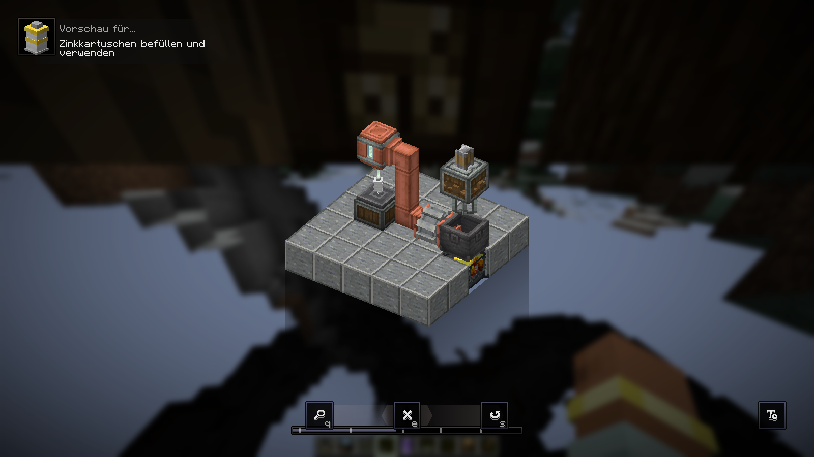
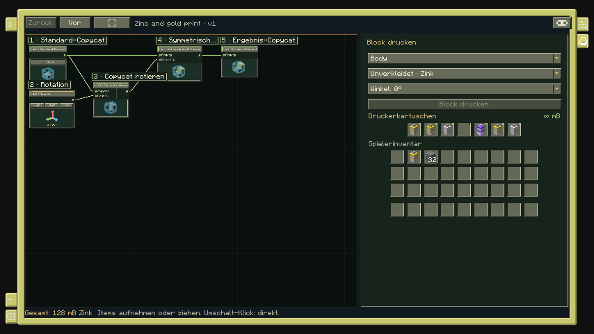

# Kartuschen und Materialien

> Stand: **8. November 2026**. Diese Spielanleitung beschreibt die **lokale Mod 0.5.1**. Der kleinere Funktionsumfang des **Graphstudio 0.3** ist im [Entwicklungsstand](Entwicklungsstand.md) getrennt ausgewiesen.

[Wiki-Start](Home.md) · [Blockdrucker](Blockdrucker.md) · [Formeditor](Formeditor.md)

Ein gedruckter Copycat benötigt **Zink für seine Geometrie** und auf Wunsch **Blockitems als Verkleidung**. Zink bestimmt die vorhandene Form; die Verkleidung bestimmt deren Aussehen. **Unverkleidet · Zink** benötigt ausschließlich Rohmaterial.

## Kartuschen herstellen und befüllen

Eine volle Standardkartusche enthält **256 mB flüssiges Zink**. Ein Zinkbarren liefert **144 mB**. Deshalb reicht ein Barren nicht für eine vollständig gefüllte Kartusche oder einen Vollblock.

| Herstellung | Ergebnis |
|---|---|
| Zwei Papier nebeneinander | Eine leere Kartusche |
| Papier – Zinkbarren – Papier in einer Reihe | Eine Kartusche mit 144 mB |
| Leere Kartusche am Create-Ausguss mit 256 mB Zink befüllen | Eine volle Kartusche |

Schmelze Zink nach den Rezepten von **Create: Molten Metals – Neoforged** mit einem mechanischen Mischer über einem beheizten Create-Becken. Führe das flüssige Zink zu einem **Ausguss** und lege die Kartusche auf das Depot oder Förderband darunter. Auch angebrochene Kartuschen lassen sich auffüllen. Verwendet wird ausschließlich **`molten_metals:molten_zinc`**.

*Die Ponder-Hilfe zu Kartuschen zeigt den Weg vom Zink im Becken zur befüllten Kartusche.*

Vollständig entleerte Kartuschen werden wieder zum leeren, befüllbaren Item. Restfüllungen bleiben bei Drucken, Befüllen und Entleeren erhalten. Alte Kartuschen können gespeicherte Mengen über der heutigen Standardfüllung besitzen; ihr Inhalt bleibt nutzbar.

## Kartuschen im Drucker und in der Welt

Der Drucker besitzt **sieben Kartuschenplätze**. Im rechten Drucken-Reiter liegen sie unter den Druckeinstellungen zusammen mit dem Spielerinventar. Bei kleinem Fenster zu diesem Bereich scrollen. Kartuschen mit der Maus aufnehmen, ablegen oder ziehen; **Umschalt-Klick** verschiebt sie direkt zwischen Spieler und Drucker. Verkleidungsblöcke bleiben im Spielerinventar. In die sieben Druckerplätze passen ausschließlich Kartuschen.

*Druckeinstellungen, Kartuschen und Inventar befinden sich im selben Reiter.*

Das Gerät nimmt seine Kartuschen beim Drucken oder Abbrechen wieder mit. Für die separate Verwaltung mit gehaltenem Drucker in die Luft rechtsklicken oder **Schleichen + Rechtsklick** verwenden.

Bis zu **vier Kartuschen** lassen sich wie Kerzen auf einer tragfähigen Blockfläche aufstellen. Leere, normale und kreative Varianten dürfen sich eine Position teilen. Rechtsklick mit leerer Hand zeigt den Gesamtvorrat; **Schleichen + Rechtsklick mit leerer Haupthand** nimmt die zuletzt hinzugefügte Kartusche einzeln zurück. Beim Abbau werden alle Kartuschen mit ihren Restmengen ausgegeben. Aufgestellte Kartuschen können über Flüssigkeitsleitungen befüllt und entleert werden.

## Wie viel Zink kostet eine Form?

Der Drucker berechnet die fertige Geometrie im **16³-Raster**. 16 belegte kleine Würfel entsprechen 1 mB; pro gedruckter Blockposition wird auf ganze mB aufgerundet. Überlappungen zählen einmal, ausgeschnittene Bereiche nicht. Maßgeblich ist deshalb die Kostenanzeige des Editors.

| Einfache Form | Bedarf |
|---|---:|
| Vollblock | 256 mB |
| Stufe | 128 mB |
| Treppe | 192 mB |
| Panel | 48 mB |
| Mittige Scheibe | 32 mB |
| Halbe / Viertelscheibe | 16 / 8 mB |
| Byte | 32 mB |
| Schicht | 32 mB je Schicht |

Zinkbarren im Inventar können fehlendes Rohmaterial ergänzen. Für überschüssiges Zink benötigt das Inventar gegebenenfalls einen freien Platz für eine Restkartusche. Die **kreative Kartusche** versorgt den Drucker unbegrenzt mit Zink und wird nicht geleert. Im Survivalmodus bleiben gewählte Verkleidungsblöcke erforderlich.

## Verkleidungen und Materialgruppen

Geeignet sind gewöhnliche Vollblockitems ohne BlockEntity, außerdem Glas und entsprechende zulässige Blöcke anderer Mods. Die Form übernimmt das Aussehen, keine Inventare oder Maschinenfunktionen. Es gibt zehn vorgeschlagene Vanilla-Materialien; die zulässige Auswahl ist größer.

Pro tatsächlich verwendeter **Materialart** kostet jeder Kompositblock einen Verkleidungsblock. Zwei Gruppen desselben Blocks mit Eichenbrettern kosten zusammen einen Eichenbretterblock. Holz und Glas kosten je einen Block ihrer Art. Vollständig verdrängte Gruppen erzeugen keinen zusätzlichen Oberflächenbedarf.

Bis zu **acht Materialgruppen** lassen sich unabhängig zuweisen. Im [Formeditor](Formeditor.md) erhalten die Gruppen Namen und Prioritäten; im Drucken-Reiter wählst du Gruppe und Verkleidung. Die höhere Vordergrundpriorität gewinnt in überlappenden Bereichen. In [Gebäuden](Gebaeudeplanung.md) verbinden Materialrollen die Gruppen mit der Gebäudepalette.

## Fertige Blöcke nachträglich verkleiden

Halte einen geeigneten Verkleidungsblock und rechtsklicke auf eine **noch unverkleidete Fläche**. Die getroffene Materialgruppe erhält die Oberfläche. Wird diese Materialart bereits von einer anderen sichtbaren Gruppe desselben Blocks verwendet, kostet die weitere Zuweisung keinen zusätzlichen Block.

Zum Wechseln zuerst die alte Oberfläche mit dem **Create-Schraubenschlüssel** von der getroffenen Gruppe entfernen und anschließend das neue Material auftragen. Auch schleichende Schraubenschlüsselbenutzung entfernt die Oberfläche. Der bezahlte Verkleidungsblock wird zurückgegeben, sobald die letzte sichtbare Gruppe mit diesem Material davon befreit ist. Leere Hand auf einer Fläche zeigt Gruppenname und Material. Verkleidungen ändern darf der Besitzer; Creative-Spieler können sie ebenfalls bearbeiten.

Beim Abbau des Kompositblocks erhältst du die **bezahlte Zinkmenge als Kartusche** und die bezahlten Verkleidungsblöcke zurück. Mit kreativer Rohstoffversorgung gedruckte Geometrie erzeugt keine Zinkrückgabe. Vorhandene native Copycats lassen sich über zusätzliche Create-Schmelzrezepte recyceln; die jeweilige Menge findest du im Rezept. Andere Zutaten werden dabei verworfen.

Bei fehlendem Material oder abgelehnter Verkleidung hilft die [Fehlerhilfe](Fehlerhilfe.md). Vorgefertigte Formen findest du unter [Beispiele und Import](Beispiele-und-Import.md).

[Entwicklungsstand und Kompatibilität](Entwicklungsstand.md) · [Knotenreferenz](Knotenreferenz.md) · [Einheiten](Einheiten-und-Ausrichtung.md)
