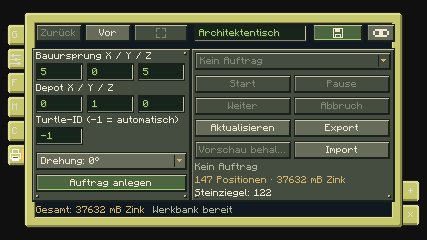

# Bauen mit einer Turtle

> Stand: **8. November 2026**. Diese Spielanleitung beschreibt die **lokale Mod 0.5.1**. Der kleinere Funktionsumfang des **Graphstudio 0.3** ist im [Entwicklungsstand](Entwicklungsstand.md) getrennt ausgewiesen.

Eine CC:Tweaked-Turtle kann ein geplantes Gebäude selbstständig errichten. Sie fährt zu jeder Bauposition, setzt den Block unter sich und lädt Material am Depot nach. Der mitgelieferte Befehl `architect` benötigt kein GPS. Die Turtle gräbt keine Hindernisse weg; Baufläche und Flugwege müssen vorbereitet sein.

Den Entwurf bereitest du am [Architektentisch](Gebaeudeplanung.md) vor. Prüfe außerdem die [Installation](Installation.md) und die benötigten [Kartuschen und Materialien](Kartuschen-und-Materialien.md).

## 1. Turtle ausrüsten

Lege einen [Blockdrucker](Blockdrucker.md) in das Inventar einer Turtle, die dir gehört. Öffne deren Terminal und starte die Lua-Konsole:

```text
lua
```

Wenn der Drucker beispielsweise in Platz 1 liegt und die rechte Upgrade-Seite frei ist:

```lua
turtle.select(1)
turtle.equipRight()
peripheral.find("copycat_architect")
```

`equipRight()` muss erfolgreich sein. Alternativ kannst du eine freie linke Seite mit `turtle.equipLeft()` verwenden. Verlasse die Lua-Konsole mit `exit()`.

Für Gebäudeaufträge reicht dieses ausgerüstete Gerät. Ein zweiter Drucker im Inventar ist nur für den unten beschriebenen physischen Einzeldruck erforderlich. Eine separate Installation des Bauprogramms entfällt: `architect` ist bereits als ROM-Programm verfügbar.

## 2. Depot und Arbeitsraum vorbereiten

Das Depot ist die **Standposition der Turtle**, nicht die Position der Materialkiste. Stelle eine Kiste oder ein Fass unmittelbar darunter. Andere Behälter werden vom automatischen Nachschub nicht verwendet.

Wähle das Depot 2–8 Blöcke nordwestlich außerhalb des Gebäudes: Sowohl X als auch Z müssen kleiner als die kleinsten tatsächlichen Baukoordinaten sein. Beachte dabei die gewählte Gebäudedrehung. Die Depot-Höhe beträgt immer **Bauursprung-Y + 1**. Bei Untergeschossen bezeichnet der Bauursprung die tiefste konstruktive Lage.

Ein einfaches Beispiel ohne Untergeschoss und ohne Drehung:

| Einstellung | X | Y | Z |
|---|---:|---:|---:|
| Bauursprung und nordwestlichste Bauzelle | 100 | 64 | 100 |
| Depot, also Turtle-Standposition | 97 | 65 | 97 |
| Kiste oder Fass | 97 | 64 | 97 |

Lasse den senkrechten Schacht über dem Depot sowie den Arbeitsraum bis über das Dach frei. Die Vorprüfung untersucht auch Flugwege und geforderte Freiräume. Bäume, Gerüste oder fremde Blöcke können den Auftrag blockieren. Der gesamte Bereich muss geladen sein.

## 3. Materialien bereitstellen

Fülle den Behälter unter dem Depot mit den im Plan angezeigten Materialien, Zinkbarren beziehungsweise gefüllten Kartuschen und ausreichend Treibstoff. Normale Baublöcke und Teppiche werden als echte Items verbraucht; verkleidete Copycats benötigen zusätzlich ihr Rohmaterial.

Das Programm verbrennt ausschließlich **Kohle, Holzkohle und Kohleblöcke**. Lege für den ersten Start auch eine Portion Kohle direkt in die Turtle. Holz aus der Materialpalette bleibt dadurch erhalten. Ein Zinkbarren liefert 144 mB Rohmaterial; der Bedarf einer Form hängt von ihrem belegten Volumen ab.

Halte das Turtle-Inventar übersichtlich und lasse Plätze frei. Beim Bezahlen mit Zinkbarren können Restmengen als Kartusche zurückkommen. Der Nachschub lädt jede benötigte Itemart bis zu insgesamt einem Stapel im Turtle-Inventar nach. Er leert die Kiste nicht ungefiltert in die Turtle.

## 4. Auftrag anlegen und starten

Öffne im Gebäudeeditor den Bereich **Bauen**. Trage Bauursprung, Depot und Drehung ein. **Turtle-ID `-1`** bedeutet automatische Zuweisung: Die erste passende Turtle beansprucht den Auftrag am Depot. Für eine feste Zuordnung lässt sich ihre ID in der Lua-Konsole mit `os.getComputerID()` ablesen.



Wähle **Auftrag anlegen**, markiere den neuen Auftrag in der Liste und drücke **Start**. Die Vorprüfung untersucht den geladenen Arbeitsraum. Währenddessen kann die Turtle bereits auf ihren Auftrag warten.

Stelle sie auf das Depot und führe im normalen Turtle-Terminal aus:

```text
architect list
architect HIER-DIE-AUFTRAGS-ID
```

Ersetze den Platzhalter durch die ID aus der Liste. Aufträge sind an Besitzer und Dimension gebunden; nach der Zuweisung arbeitet nur dieselbe Computer-ID daran. Die Turtle liest ihre tatsächliche Position und Richtung selbst aus. Sie baut, kehrt bei Materialbedarf zum Depot zurück und fährt nach Abschluss ebenfalls dorthin.

Ein Auftrag speichert die berechnete Geometrie und Materialzuordnung. Spätere Änderungen an Vorlagen ändern diesen laufenden Auftrag nicht.

## Pause, Fehler und Fortsetzen

Mit **Pause** am Tisch hältst du den Auftrag an. Sobald das Programm den neuen Zustand liest, beendet es sich; die Turtle bleibt dabei gegebenenfalls an ihrer aktuellen Arbeitsposition.

Zum Fortsetzen wählst du **Weiter** am Tisch und startest anschließend denselben `architect AUFTRAGS-ID`-Befehl erneut. **Weiter allein startet kein bereits beendetes Turtle-Programm.** Dasselbe Vorgehen gilt nach einem Hindernis oder Materialfehler: Ursache beheben, **Weiter** wählen, Programm erneut starten. Einzelne Meldungen erläutert die [Fehlerhilfe](Fehlerhilfe.md).

Fortschritt, Position und Orientierung benötigen keine lokale Positionsdatei. Bereits passende Blöcke werden nicht nochmals berechnet. **Abbruch** lässt bereits errichtete Blöcke stehen; zum Weiterbauen eines abgebrochenen Entwurfs ist ein neuer Auftrag erforderlich.

## Nach einem Neustart automatisch starten

Öffne `edit startup.lua` und trage ein:

```lua
shell.run("architect", "HIER-DIE-AUFTRAGS-ID")
```

Speichere die Datei und führe `reboot` aus. Das startet das Programm beim Booten. Ein pausierter oder blockierter Auftrag muss weiterhin am Tisch mit **Weiter** freigegeben werden.

## Einzelne Formdatei drucken

Für einen einzelnen Druck aus einer exportierten [Form](Formeditor.md) brauchst du zusätzlich einen zweiten Drucker im Inventar, passende Ressourcen und einen freien Rückgabeplatz:

```text
architect print front my-form.json palette.json 0
architect print up my-form.json - 1
architect history
architect save-print DRUCKVERLAUF-ID Meine Form
```

`palette.json` kann beispielsweise `{"body":"minecraft:oak_planks"}` enthalten; die Gruppen-ID muss zur Form passen. `-` wählt eine unverkleidete Form. `front`, `up` und `down` beziehen sich auf die Turtle, die Drehung `0`–`3` auf absolute Vierteldrehungen um Y. Das Gerät wird nach dem Druck zurückgegeben. Weitere Dateien findest du unter [Beispiele und Import](Beispiele-und-Import.md), die vollständigen Methoden in der [Lua-API](../LUA_API.md).

[Zur Wiki-Startseite](Home.md)

[Entwicklungsstand und Kompatibilität](Entwicklungsstand.md) · [Knotenreferenz](Knotenreferenz.md) · [Einheiten](Einheiten-und-Ausrichtung.md)
